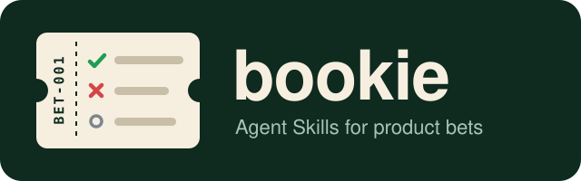

<p align="center">
  
</p>

<h3 align="center">Set the kill criteria before your agent writes line one.</h3>

<p align="center">
Five Agent Skills for Claude Code and other coding agents.<br>
Run each product idea as a bet: fixed terms, a thin build, real users,<br>
and a go, no-go, or pivot call on a date you pick first.
</p>

<p align="center">
  <code>npx skills add niccolox/devekko.bookie</code>
</p>

---

## 🤔 Your agent builds fast. Who decides if it should?

Claude Code can scaffold a FastAPI backend, a React UI, auth, and tests in an afternoon. Then you spend a month on polish for a demo that nobody asked for.

You know the pattern. The demo works. Three friends say "nice". One person will "probably pay". So you move the decision date by two weeks, then again.

Bookie is the friend who wrote the date down. 🎲

## 🎲 How a bet works

A bookie writes the terms down before the game and pays out on the final score. Bookie does that for a product idea.

- 📝 **Terms first.** Before the first line of code, you write a core question, 3 to 6 kill criteria, and a decision date. Each criterion has a number and names its evidence. For example: "4 of 10 trial users run the report a second time in week 2."
- 🔒 **Terms stay put.** After the frame stage, no agent changes a criterion, a threshold, or the date. Only you can, and the record shows the change.
- 👀 **Only acts count.** The Customer evidence table logs only what a person did: a second login, a payment, a cancellation. A compliment goes nowhere.
- ⚖️ **Settled on the date.** At the score stage, the agent runs the evidence commands again and marks each criterion `met` or `not met`. You write the memo and make the call.

A no-go on the decision date costs you two to four weeks of build. You get those weeks back on the next idea.

## 📒 The register

Every bet lives in one table, `BOOKIE.md`, at the root of your repo. Bookie writes it again after each stage. Here it is with three bets:

| Bet | Name | Status | Stage | Decision date | Criteria | Updated |
| --- | --- | --- | --- | --- | --- | --- |
| BET-001 | Invoice match | Decided: no-go | finished | 2026-09-30 | 1 met, 3 not met | 2026-09-30 |
| BET-002 | Weekly cash report | With users | iterate (9 of 11) | 2026-12-04 | 2 met, 2 open | 2026-11-16 |
| BET-003 | Supplier risk alerts | Framing | frame (2 of 11) | | none | 2026-11-17 |

How to read it:

- ❌ **BET-001** ran to its date and missed 3 of 4 criteria. It stays in the table, so the next idea starts with a record of what failed.
- 🧪 **BET-002** has real users and is in its weekly fix loop, with 2 criteria met and 2 still open.
- 📝 **BET-003** is still at the frame stage. Its agent writes no code until you confirm the criteria and the date.

And how it works:

- 🤖 **Agents read it first.** `AGENTS.md` tells each agent to check the register before a task. When the bet is not at the build stage, the agent stops and asks you to type `/bookie BET-NNN`.
- ✍️ **Bookie writes it.** The script owns the file, so an edit by hand is replaced at the next stage.
- 🔐 **Private when you want.** Keep the bet record out of git, and `BOOKIE.md` stays out of git too.

## 🧑‍💻 Built for developers

- 🧱 **Your stack, ready.** Pick FastAPI and React at setup, and Bookie writes the commands for both parts into `AGENTS.md` and the layout into `DESIGN.md`. Python, TypeScript, and other stacks work too.
- 🌿 **One commit per stage.** Each stage lands as `bookie(BET-NNN): <stage> done` on the branch `bet/bet-nnn`. Review it or revert it like any commit. Secrets stay out, and nothing is pushed.
- 🧪 **Evals before the build.** You collect 20 to 50 real examples and turn them into an eval set before the thin slice exists.
- 🛠️ **Builds with poteto-mode.** The build stage hands each unit to `/poteto-mode` from [pstack](https://github.com/backnotprop/pstack). Each verified unit goes to the build log.
- 🙋 **You make the product calls.** The criteria, the date, the scope, the first users, and the decision come to you as questions in the agent.
- 📦 **Files in your repo.** The skills are Markdown and Python standard-library scripts. There is no account to create and no server to run.

## 🗺️ Eleven stages, one gate each

Each stage must pass its gate before the next one starts.

| # | Stage | What happens |
| ---: | --- | --- |
| 1 | 🏗️ setup | Writes `AGENTS.md`, `CLAUDE.md`, `PRODUCTS.md`, `DESIGN.md`, and the register. |
| 2 | 📝 frame | Core question, kill criteria, and decision date. You confirm them. |
| 3 | 🛒 build-or-buy | At most one hour to find what already solves the problem. |
| 4 | 🎯 scope | 20 to 50 real examples and one success metric. |
| 5 | 🧪 evals | An eval set with yes/no checks and a judge rubric. |
| 6 | 🔨 build | The thin slice, built with `/poteto-mode` and run against the evals. |
| 7 | 🛡️ harden | The checks to make before real users see it. |
| 8 | 👥 users | Real users, and a log of what they did. |
| 9 | 🔁 iterate | Each week, turn failures into eval cases and fix the top one. |
| 10 | ⚖️ score | Each criterion marked `met` or `not met` from fresh evidence. |
| 11 | 🏁 memo | Go, no-go, or pivot, in writing. |

Stop at any stage. `/bookie BET-001` continues at the same stage, with your answers saved.

## 🚀 Install bookie in a project

You install the skills with the [`skills` CLI](https://skills.sh), like any other skill. The first skill that you run, `/setup-bookie`, then adds [pstack](https://github.com/backnotprop/pstack), which the bet skills use.

You need Node.js for `npx`, `git`, and Python 3.11 or later.

1. Install the skills. Run this from the root of your project:

   ```bash
   npx skills add niccolox/devekko.bookie
   ```

   The CLI lists the five skills. Select all five, then select your agents. `bookie` and `setup-bookie` use scripts from the skill folders beside them, so install the five skills together.

   To install with no questions, name the skills and the agent:

   ```bash
   npx skills add niccolox/devekko.bookie --skill '*' -a claude-code -y
   ```

2. Set up the project. Start your agent in the project and type the command:

   ```text
   /setup-bookie
   ```

   The skill does these steps in order:

   - **Pstack.** It checks that the project has the pstack skills. When they are missing, it installs them from `backnotprop/pstack` with the same `skills` CLI.
   - **Models.** It picks the pstack models and writes them into the project.
   - **Project files.** It asks for the stack and the surface. FastAPI and React is the recommended stack: a FastAPI API on Python with `uv`, and a React UI with TypeScript in `web/`. Then it writes `AGENTS.md`, `CLAUDE.md`, `PRODUCTS.md`, `DESIGN.md`, and `.gitignore`. A file that exists keeps its text and gets only its missing lines. It also writes `BOOKIE.md`, the register of the bets.
   - **Commit.** It turns `/setup-pstack` off for the project and makes one commit on the branch `setup/bookie`. In a folder with no git repository, it runs `git init` first. It never pushes.

3. Start the first bet:

   ```text
   /bookie
   ```

   The skill asks for one paragraph about the problem, then runs the stages in order. Later, `/bookie BET-001` continues at the stage where the last run stopped.

### What the install adds to your project

| Path | What it is |
| --- | --- |
| `.claude/skills/<name>` | Each skill, where Claude Code reads it. |
| `.agents/skills/<name>/` | Present when the CLI installs for several agents. It then holds the files, and `.claude/skills/<name>` is a link to them. |
| `skills-lock.json` | The source and the commit of each skill. Commit this file. |

The skills can be in different layouts in one project. An update can also move a skill from a folder to a link. The scripts find the skills beside them in every mix of the two.

### Update

```bash
npx skills update
```

The CLI checks each source in `skills-lock.json` and updates the skills that changed. This covers the bet skills and pstack. Read `git diff` after an update, because an update can replace a change that you made to an installed skill.

### Install pstack yourself

You can install pstack before `/setup-bookie`. The skill then finds it and installs nothing:

```bash
npx skills add backnotprop/pstack --skill '*' -y
```

## 🧩 Skills

| Skill | What it does |
| --- | --- |
| [`setup-bookie`](skills/setup-bookie/SKILL.md) | Sets up a project in one pass, in place of `setup-pstack`: pstack, model settings, project files, `.gitignore`, and a commit. |
| [`bookie`](skills/bookie/SKILL.md) | Runs one bet from setup to the memo. |
| [`bet-record`](skills/bet-record/SKILL.md) | Keeps the bet record: core question, kill criteria, decision date, build log, score, and memo. |
| [`bet-diligence`](skills/bet-diligence/SKILL.md) | Writes a diligence memo on a dependency, product, or company, with evidence for each finding. |
| [`bet-discovery`](skills/bet-discovery/SKILL.md) | Plans customer interviews and logs only what people did. |

Each skill starts only from its slash command.

## 🔧 Develop the skills

This part is for a person who changes the skills. It needs `uv`, `make`, and `rsync`.

```text
skills/<name>/           The source of each skill: SKILL.md, scripts/, references/
.claude/skills/<name>    A link to skills/<name>, so a session here loads the source
vendor/pstack/           The upstream pstack skills (git ignores this folder)
pstack.lock              The upstream source, branch, and commit hash
scripts/, tests/         The scripts that the Makefile runs, and their tests
sandbox/                 Test projects (git ignores this folder)
docs/status.md           The current state and the open work
```

```bash
make install     # the development tools
make pstack      # the upstream skills
make check       # lint, types, and tests on Python 3.11
```

Run `make help` for every command. [AGENTS.md](AGENTS.md) holds the rules for a change to a skill.

### Upstream pstack in this repository

A session in this repository, and each sandbox, uses the pstack skills from `vendor/pstack/`. `pstack.lock` names their source:

```json
{
  "source": "backnotprop/pstack",
  "branch": "main",
  "commit": "<the hash of the last pull>",
  "synced": "<the date of the last pull>"
}
```

| Command | What it does |
| --- | --- |
| `make pstack` | Asks GitHub for the branch's current hash. Pulls the files into `vendor/pstack/` only when that hash differs from the hash of the local copy. |
| `make pstack-check` | Compares the two hashes and pulls nothing. |

With no network, each command keeps the local copy. `setup-bookie` installs pstack from the same source, and a test fails when the two differ. To use another source, change `source` in `pstack.lock` and `PSTACK_SOURCE` in `skills/setup-bookie/scripts/setup_bookie.py`.

### Test a change before you publish it

`npx skills add` installs the version on GitHub. To test the working copy, use one of these:

```bash
make sandbox NAME=demo            # a new test project in sandbox/demo
make bookie REPO=../my-project    # an existing project
```

Both copy the working copy of the five bet skills, and the pstack skills from `vendor/pstack/`, into the project's `.claude/skills/`. `make bookie` keeps a pstack skill that the project already has. It runs no git command in the project.

Then start a session in the project and type `/setup-bookie`, then `/bookie`. A sandbox has its own git repository, so the bookie commits stay inside it. The skills in a project are copies, so install again after a change to the source. `make sandbox-clean` removes every sandbox.

### Publish

A push to `main` of this repository publishes the skills, because `npx skills add` and `npx skills update` read it. Run `make check` first.

A second public copy is in the fork [`niccolox/pstack-bets`](https://github.com/niccolox/pstack-bets), with a checkout at `../pstack-bets`. [docs/status.md](docs/status.md) says which version that copy holds.

```bash
make fork-diff     # shows which skills differ from the checkout
make fork-copy     # copies the skills into ../pstack-bets/skills
```

`fork-copy` runs no git command. Make the branch, the commit, and the PR in the checkout.
